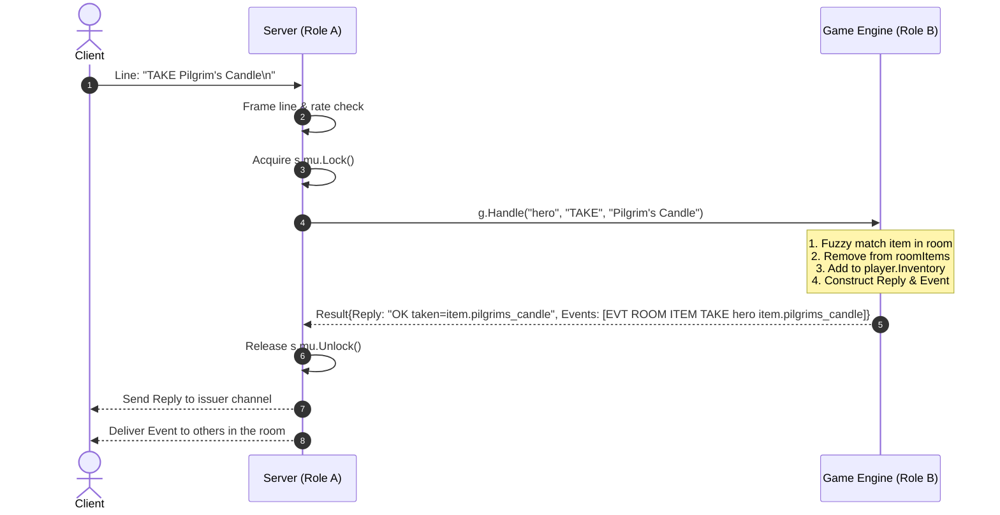

# 🏗️ Project Architecture & Problem Analysis

Back to: [[00 - Dashboard]]

---

## 1. What is the Problem?

In **The Answer Protocol (TAP)**, our team is tasked with building a multiplayer retro text adventure (a **MUD** — Multi-User Dungeon) based on the **RFC 42TAP** standard. 

Developing a multi-client server over raw TCP sockets introduces several core systems challenges:

```
                                  CONCURRENCY HAZARDS
                  ┌────────────────────────┴────────────────────────┐
                  ▼                                                 ▼
      Race Conditions on State                           Network I/O Headaches
• Two players grab the same item                  • Slow clients stall broadcasts
• Concurrent attacks on one enemy                 • Stream fragmentation (half-lines)
• Deadlocks between socket & game locks           • Dropped sockets mid-broadcast
```

1. **State Consistency & Race Hazards**: Multiple players issue commands concurrently from separate network sockets. If two players attempt to `TAKE` the same unique item at the same microsecond, or simultaneously hit an enemy whose HP drops to zero, the game state will corrupt without strict synchronization.
2. **TCP Stream Framing**: TCP does not deliver discrete messages; it delivers continuous streams of bytes. Commands may arrive sliced across multiple packets or concatenated into a single buffer. The server must frame lines strictly on `\n`, enforce a 1024-byte ceiling, reject non-UTF-8 characters, and discard control sequences.
3. **Broadcast Decoupling & Slow Clients**: When an event occurs (e.g., player enters a room or global chat is sent), the server must notify many clients. If one client has high latency or stops reading, a naive synchronous write will freeze the entire server broadcast loop.
4. **Strict Protocol Compliance & Interoperability**: In 42 evaluations, our server will be tested with other groups' CLI and GUI clients, and our clients will be evaluated against external servers. We must adhere strictly to RFC 42TAP grammar, error numbers, and payload formats.

---

## 2. How Are We Solving It?

We structure the project into clean, decoupled layers, dividing responsibilities among three teammates:

```
[CLI Client] ---------------- TCP Socket ----------------+
                                                         │
[GUI Client] <── WebSocket ──> [Go Bridge] ── TCP ──> [TCP Server (Role A)]
                                                         │
                                                         │ Passes lines
                                                         ▼
                                                [Game Engine (Role B)]
                                                • Pure Go Logic
                                                • Single Mutex Barrier
                                                • Loads data/world.yaml
```

### The Single-Lock Concurrency Model
Rather than distributing fine-grained mutexes across players, rooms, items, and NPCs (which inevitably leads to race conditions and deadlocks), the architecture uses a **Single Mutex Barrier**:

> [!IMPORTANT]
> **The Golden Rule of Game State Concurrency:**
> Network I/O is asynchronous across independent goroutines. However, **every mutation and query of game state is executed under a single mutex** (`s.mu.Lock()`) inside the server before delegating to `game.Handle(...)`.

Because the game engine is called sequentially:
- **Zero internal locks**: Code written by Role B (`room.go`, `item.go`, `combat.go`, `quest.go`) requires **no mutexes**.
- **Pure Determinism**: State mutations are 100% predictable and free of data races.
- **Trivial Unit Testing**: Role B can test the entire game state in memory with standard `go test` without launching a single TCP socket or mock network interface.

### Slow Client Protection
Every client connection possesses a dedicated 256-line buffered outgoing channel (`chan string, 256`). When the server delivers an event:
- It pushes to the client's channel without blocking.
- If a client's buffer reaches capacity (because the client stopped reading), the server drops the connection, cleans up the player state, and continues broadcasting to everyone else.

---

## 3. The Contract Between Network and Game Engine

The interface between **Role A** (Server) and **Role B** (Game Logic) is defined in `internal/game/game.go`:

```go
package game

// Event is one line to push to a set of players.
type Event struct {
    To   []string // List of recipient player names
    Line string   // Full wire line, e.g. "EVT ROOM CHAT alice hello"
}

// Result is what a command produces.
// The server sends Reply first, then delivers Events.
type Result struct {
    Reply  string   // Wire reply sent exclusively to issuer, e.g. "OK room=loc.market"
    Events []Event  // Wire events broadcast to targeted recipients
    Close  bool     // True after QUIT, triggers socket shutdown
}

// Contract methods called by the server under s.mu.Lock():
func (g *Game) Connect(name string) Result
func (g *Game) Handle(player, cmd, args string) Result
func (g *Game) Disconnect(player string) []Event
```

### Flow of One Command



---

## 4. End-to-End Project Flow

1. **Bootstrapping**:
   - `cmd/server/main.go` parses `-port` and `-world` flags.
   - Calls `world.Load(worldPath)`: parses YAML, runs `Validate()`. On failure, the server terminates immediately with a structured error log.
   - Initializes `game.New(w, log)` and starts listening on TCP.
2. **Client Handshake**:
   - Client connects; server sends greeting `OK hello proto=1`.
   - Client sends `CONNECT <username>`.
   - `game.Connect` verifies name (1-32 chars, UTF-8, no spaces, unique).
   - Player is placed in `world.Map.Start` (`loc.votive_chapel`) with 100 HP.
   - Server returns `OK connected` and announces presence with `EVT ROOM PRESENCE ENTER` and `EVT STATS`.
3. **Gameplay Interaction**:
   - Client sends commands (`LOOK`, `MOVE`, `TAKE`, `DROP`, `ATTACK`, `DEFEND`, `FLEE`, `STATUS`, `QUEST`, `QUESTS`).
   - Server routes to `game.Handle` and broadcasts resulting events.
4. **Disconnection & Cleanup**:
   - Triggered by `QUIT` or dropped connection.
   - Server removes player from registry, calls `game.Disconnect(name)`.
   - **Crucial Rule**: `dropAllItems(p)` dumps carried items into the player's room so quest items are never permanently lost.
   - Server broadcasts `EVT ROOM PRESENCE LEAVE` and `EVT STATS`, then tears down the connection.

---

## 5. Next Steps for Person B

Review the technical terminology in [[02 - Protocol & Terminology]] and jump directly to your milestone roadmap in [[03 - Role B Plan & Milestones]].
