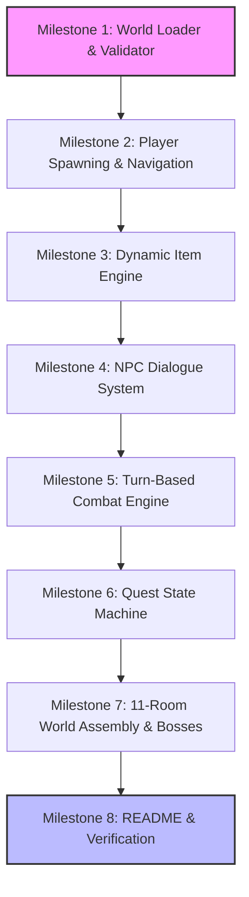

# ⚔️ Person B (Role B) Master Plan & Testable Milestones

Back to: [[00 - Dashboard]] | Architecture: [[01 - Project Architecture]] | Rules: [[04 - Game Rules & Formulas]]

---

## 🎯 Role B Responsibilities Overview

As **Person B**, you are the architect of the **Game Engine, World Data, and Rules**. You own:
- Static world ingestion & graph validation (`internal/world/`)
- Dynamic item management, inventory & uniqueness (`internal/game/item.go`)
- Room navigation & spatial presence (`internal/game/room.go`)
- NPC dialogue interaction (`internal/game/npc.go`)
- Turn-based combat engine, flee/defend, & death/respawn (`internal/game/combat.go`)
- Quest state machine & group kill credit (`internal/game/quest.go`)
- Full 11-room world specification (`data/world.yaml`)
- Automated unit test suite for all game rules (`*_test.go`)

> [!TIP]
> **Key Advantage**: You write pure Go logic. No sockets, no goroutines, no network channels, and no mutexes. You can develop and test 100% of your work using `go test` in milliseconds!

---

## 📅 Roadmap Overview



---

## 🧩 Detailed Milestone Breakdown

---

### Milestone 1: Static World Data Ingestion & Validation (`internal/world`)

#### 🎯 Goal
Implement `world.Load(path string)` and `w.Validate() error`. This unblocks `cmd/server/main.go` and allows the entire team to start the real server.

#### 📁 Files Touched
- `internal/world/world.go` (implement `Load`)
- `internal/world/validate.go` (implement graph & reference checks)
- `internal/world/world_test.go` (new test suite)

#### 🛠️ What We Build
1. **YAML Unmarshaling (`world.go`)**:
   - Read file bytes from `path`.
   - Parse YAML into `World` struct using `gopkg.in/yaml.v3`.
   - Call `w.Validate()`. Return error if validation fails.
2. **Graph Validation (`validate.go`)**:
   - Verify `Map.Start` exists in `Map.Rooms`.
   - Verify `Map.SafeRoom` exists in `Map.Rooms`.
   - Iterate over all rooms:
     - Check each exit direction points to a valid room ID in `Map.Rooms`.
     - Check each item ID listed in `room.Items` exists in `w.Items`.
     - Check each NPC ID listed in `room.NPCs` exists in `w.NPCs`.
   - Iterate over all quests:
     - Check `quest.Giver` exists in `w.NPCs`.
     - If `objective.Kill != ""`, target must exist in `w.NPCs` and have `role: enemy`.
     - If `objective.Deliver != ""`, item must exist in `w.Items`.
     - If `quest.Needs != ""`, referenced quest must exist in `w.Quests`.
     - If `reward.Item != ""`, item must exist in `w.Items`.
   - Return descriptive error on the first broken reference: e.g. `fmt.Errorf("room %q exit %q points to unknown room %q", roomID, dir, target)`.

#### 🧪 Testable Verification (`internal/world/world_test.go`)
- **Test 1**: Load valid `data/world.yaml` $\rightarrow$ succeeds without error.
- **Test 2**: Missing file $\rightarrow$ returns filesystem error.
- **Test 3**: Room with exit pointing to `"loc.nowhere"` $\rightarrow$ `Validate()` returns error mentioning `"loc.nowhere"`.
- **Test 4**: Room referencing missing item `"item.fake"` $\rightarrow$ `Validate()` fails.
- **Test 5**: Quest with circular or non-existent `needs` $\rightarrow$ `Validate()` fails.

---

### Milestone 2: Player Spawning, Spatial Navigation & Presence (`internal/game/room.go`)

#### 🎯 Goal
Implement player state initialization in `newPlayer`, the `LOOK` command with RFC-compliant JSON, and room-to-room navigation with `MOVE`.

#### 📁 Files Touched
- `internal/game/game.go` (update `Player` and `Game` state)
- `internal/game/room.go` (implement `newPlayer`, `look`, `move`)
- `internal/game/room_test.go` (new test suite)

#### 🛠️ What We Build
1. **Player State (`game.go`)**:
   - Extend `Player`:
     ```go
     type Player struct {
         Name        string
         Room        string
         HP          int
         MaxHP       int
         DamageBonus int
         Inventory   []string // list of item IDs
         Quests      map[string]*QuestProgress
         InCombat    bool
         CombatTarget string
         Defending   bool
     }
     ```
   - In `newPlayer(name string)`: spawn player in `g.world.Map.Start`, initialize `HP: 100`, `MaxHP: 100`, empty inventory, empty quests.
2. **`LOOK` Handler (`look(p)`)**:
   - Assemble current room info, player list (excluding `p` or including per RFC), item list, and NPC list.
   - Construct RFC 42TAP Section 5.1.2 response:
     ```json
     OK {"room":{"id":"loc.chapel","name":"Votive Chapel","description":"...","exits":{"north":"loc.gate"}},"players":[],"items":["item.candle"],"npcs":["npc.sister_ilvane"]}
     ```
3. **`MOVE <direction>` Handler (`move(p, args)`)**:
   - Look up `p.Room` in `g.world.Map.Rooms`.
   - Check if `args` (e.g. `"north"`, `"east"`) exists in `room.Exits`.
   - If not found: return `Result{Reply: protocol.ErrNoExit}` (`ERR 301 NO_EXIT`).
   - If player is engaged in combat: enemy gets a **Free Hit** before the player flees!
   - Update `p.Room = targetRoomID`.
   - Clear combat state.
   - If entering `safe_room`: restore `p.HP = p.MaxHP`.
   - Reply: `OK room=<new-room-id>`.
   - Events:
     - `EVT ROOM PRESENCE LEAVE <name>` $\rightarrow$ sent to old room occupants.
     - `EVT ROOM PRESENCE ENTER <name>` $\rightarrow$ sent to new room occupants.

#### 🧪 Testable Verification (`internal/game/room_test.go`)
- **Test 1**: `newPlayer("alice")` places Alice in `loc.votive_chapel` with 100 HP.
- **Test 2**: `LOOK` returns valid JSON with correct exits and contents.
- **Test 3**: `MOVE east` updates `p.Room`, returns `OK room=loc.pilgrims_road`, emits `LEAVE` to chapel and `ENTER` to road.
- **Test 4**: `MOVE up` when no up exit exists returns `ERR 301 NO_EXIT`, room unchanged.

---

### Milestone 3: Dynamic Item Lifecycle, Uniqueness & Fuzzy Matching (`internal/game/item.go`)

#### 🎯 Goal
Guarantee item uniqueness in memory, implement multi-word fuzzy name matching, and support `TAKE`, `DROP`, `INVENTORY`, and `dropAllItems`.

#### 📁 Files Touched
- `internal/game/game.go` (track room items)
- `internal/game/item.go` (implement fuzzy resolver, take, drop, inventory, dropAllItems)
- `internal/game/item_test.go` (new test suite)

#### 🛠️ What We Build
1. **Dynamic Item Placement (`game.go`)**:
   - `Game.roomItems map[string][]string`: initialized in `game.New` by copying room items from `world.Map.Rooms`.
2. **Fuzzy Item Resolver (`item.go`)**:
   - Match item by:
     - Exact Full ID: `item.pilgrims_candle`
     - Short ID: `pilgrims_candle`
     - Display Name (case-insensitive): `Pilgrim's Candle` or `pilgrim's candle`
3. **`TAKE <item>`**:
   - Search room items using fuzzy resolver. If absent $\rightarrow$ `ERR 404 ITEM_NOT_FOUND`.
   - Check `Item.Obtainable`. If `false` $\rightarrow$ `ERR 404 ITEM_NOT_FOUND`.
   - Remove item from room slice, append to `p.Inventory`.
   - Apply item stat bonuses (`damage_bonus`, `max_hp_bonus`).
   - Reply: `OK taken=<item-id>`.
   - Event: `EVT ROOM ITEM TAKE <player> <item-id>` sent to others in room.
4. **`DROP <item>`**:
   - Search `p.Inventory` using fuzzy resolver. If absent $\rightarrow$ `ERR 404 ITEM_NOT_IN_INVENTORY`.
   - Remove from `p.Inventory`, append to room items.
   - Remove item stat bonuses.
   - Reply: `OK dropped=<item-id>`.
   - Event: `EVT ROOM ITEM DROP <player> <item-id>` sent to others in room.
5. **`INVENTORY`**:
   - Return `OK ["item.id1","item.id2"]` (RFC format).
6. **`dropAllItems(p)`**:
   - Dumps all items in `p.Inventory` into `p.Room`. Invoked on disconnect and death.

#### 🧪 Testable Verification (`internal/game/item_test.go`)
- **Test 1**: Take item by display name (`"TAKE Pilgrim's Candle"`) succeeds $\rightarrow$ in inventory, gone from room.
- **Test 2**: Second player attempting `TAKE` on the same item gets `ERR 404 ITEM_NOT_FOUND` (no duplication).
- **Test 3**: Unobtainable item (`item.sealed_altar`) returns `ERR 404 ITEM_NOT_FOUND`.
- **Test 4**: `DROP` places item back in room; another player can now take it.
- **Test 5**: `dropAllItems` leaves all carried items in the room on disconnect.

---

### Milestone 4: NPC Interaction & Dialogue Engine (`internal/game/npc.go`)

#### 🎯 Goal
Implement `TALK <npc>` supporting fuzzy matching and cycling dialogue lines.

#### 📁 Files Touched
- `internal/game/npc.go` (implement talk handler and dialogue rotation)
- `internal/game/npc_test.go` (new test suite)

#### 🛠️ What We Build
1. Match NPC in `p.Room` by ID (`npc.sister_ilvane`), short ID (`sister_ilvane`), or display name (`Sister Ilvane`).
2. If NPC not present in room $\rightarrow$ `Result{Reply: protocol.ErrNPCNotFound}` (`ERR 404 NPC_NOT_FOUND`).
3. If enemy NPC is dead $\rightarrow$ `ERR 404 NPC_NOT_FOUND`.
4. Cycle through `NPC.Dialogue` lines on each talk invocation.
5. Return RFC format: `OK <dialogue text>`.

#### 🧪 Testable Verification (`internal/game/npc_test.go`)
- **Test 1**: `TALK sister_ilvane` in chapel returns first dialogue line.
- **Test 2**: Second `TALK` returns second dialogue line.
- **Test 3**: `TALK rotting_sentry` while in chapel returns `ERR 404 NPC_NOT_FOUND`.

---

### Milestone 5: Turn-Based Combat Engine, Initiative & Respawn (`internal/game/combat.go`)

#### 🎯 Goal
Implement `ATTACK`, `DEFEND`, `FLEE`, `STATUS`, damage RNG, counterattacks, enemy 45s respawn, and player safe-room respawn at 50 HP.

#### 📁 Files Touched
- `internal/game/combat.go` (implement combat logic)
- `internal/game/combat_test.go` (new test suite)

#### 🛠️ What We Build
1. **Dynamic NPC State (`Game.npcState map[string]*NPCState`)**:
   - Tracks `CurrentHP`, `Dead bool`, `RespawnAt time.Time`.
   - On room entry or attack: if `Dead` and `time.Now().After(RespawnAt)`, resurrect with full HP.
2. **`ATTACK <npc>`**:
   - Check target in room $\rightarrow$ must exist and be alive, else `ERR 404 NPC_NOT_FOUND`.
   - Check role is `enemy` $\rightarrow$ if friendly/questgiver, return `protocol.ErrNPCNotHostile` (`ERR 405 NPC_NOT_HOSTILE`).
   - Boss rule: If target is Baal and nobody in room holds `item.unspoken_question`, player damage is 0!
   - Player damage formula: `8 + rand.Intn(5) + p.DamageBonus`.
   - Deal damage to NPC.
   - If NPC dies:
     - Mark dead, set `RespawnAt = time.Now().Add(45 * time.Second)`.
     - Award kill credit to `p` and party members in the room (`g.groupMembersInRoom(p)`).
     - Clear combat engagement.
     - Event: `EVT ROOM COMBAT <player> <npc-id> {"damage":dmg,"target_hp":0}`.
     - Reply: `OK {"attacker_hp":p.HP,"target_hp":0,"damage":dmg,"status":"healthy|wounded"}`.
   - If NPC survives:
     - NPC counterattacks: enemy damage = `rand.Intn(max-min+1) + min`.
     - If `p.Defending` is true: damage is halved (`dmg / 2`), `Defending` reset.
     - Deduct from `p.HP`.
     - **Player Death**: If `p.HP <= 0`:
       - Player respawns in `loc.votive_chapel` with `HP: 50`.
       - Carried items preserved (per plan).
       - Combat state cleared.
     - Event & Reply broadcast.
3. **`DEFEND`**:
   - Must be in combat, else `protocol.ErrNotInCombat` (`ERR 408 NOT_IN_COMBAT`).
   - Sets `p.Defending = true`. Enemy hits back with half damage.
   - Reply: `OK {"hp":p.HP,"damage_taken":dmg,"status":"combat"}`.
4. **`FLEE`**:
   - Must be in combat, else `ERR 408 NOT_IN_COMBAT`.
   - Selects random exit. 50% chance of taking a counterattack hit before moving.
   - Clears combat state, moves player to chosen room.
5. **`STATUS`**:
   - Returns HP, MaxHP, and status (`"combat"`, `"healthy"`, or `"wounded"`).

#### 🧪 Testable Verification (`internal/game/combat_test.go`)
- **Test 1**: Attack friendly NPC returns `ERR 405 NPC_NOT_HOSTILE`.
- **Test 2**: Attack enemy deals damage and player takes counterattack damage.
- **Test 3**: Defend halves incoming counterattack damage.
- **Test 4**: Fatal damage reduces player HP to 0 $\rightarrow$ player immediately respawns in `loc.votive_chapel` with 50 HP.
- **Test 5**: Dead enemy respawns after 45 seconds.

---

### Milestone 6: Quest Progression State Machine & Party Credit (`internal/game/quest.go`)

#### 🎯 Goal
Implement `QUEST <npc>` and `QUESTS` supporting prerequisites, fetch quests, kill quests, and party credit.

#### 📁 Files Touched
- `internal/game/quest.go` (implement quest state machine)
- `internal/game/quest_test.go` (new test suite)

#### 🛠️ What We Build
1. **Quest Lifecycle per Player**:
   - States: `available` $\rightarrow$ `active` $\rightarrow$ `completed`.
2. **`QUEST <npc>`**:
   - Find NPC in room. If absent $\rightarrow$ `ERR 404 NPC_NOT_FOUND`.
   - Find quests given by this NPC.
   - Check `needs` prerequisite: must be marked `completed` in `p.Quests`.
   - If not yet accepted: accept quest, set state `active`, reply `status: "available"`.
   - If already active: check objectives:
     - `kill`: verify target NPC was slain by player/group.
     - `deliver`: verify player holds required item in inventory.
   - If objective satisfied:
     - If delivery quest: remove item from player, return item to its original spawn room so others can complete the quest!
     - Grant rewards: add `DamageBonus`, `MaxHPBonus`, title, and grant reward item (if obtainable and free).
     - Mark quest `completed`.
     - Reply: `status: "completed"`.
   - If objective not met: reply `status: "active"`.
   - If no more quests from this NPC: `protocol.ErrNoQuest` (`ERR 406 NO_QUEST_AVAILABLE`).
3. **`QUESTS`**:
   - Return JSON list of player's active and completed quests.

#### 🧪 Testable Verification (`internal/game/quest_test.go`)
- **Test 1**: First `QUEST sister_ilvane` accepts "A Road Without Watchers" (`status: available`).
- **Test 2**: Calling `QUEST` again before killing sentry returns `status: active`.
- **Test 3**: After defeating sentry, calling `QUEST` awards +2 damage bonus and returns `status: completed`.
- **Test 4**: Delivery quest takes burial shroud from inventory, completes, and returns shroud to library.
- **Test 5**: Quest 3 ("The Last Toll") returns `ERR 406` until Quest 1 is completed.

---

### Milestone 7: 11-Room World Assembly & Boss Integration (`data/world.yaml`)

#### 🎯 Goal
Write the complete lore, topological room graph, 9 NPCs, 8 items, 5 quests, and boss mechanics into `data/world.yaml`.

#### 📁 Files Touched
- `data/world.yaml` (full world data)
- `internal/world/world_test.go` (full validation test)

#### 🛠️ What We Build
- **11 Rooms**: Votive Chapel, Pilgrim's Road, Silent Market, Hanged Garden, Burned Library, Throne Ruin, Bell Tower, Ossuary, Crypt Gate, Sunken Stair, Hall of the Answer.
- **Full Circuit Loop**: Chapel $\rightarrow$ Road $\rightarrow$ Market $\rightarrow$ Garden $\rightarrow$ Library $\rightarrow$ Throne $\rightarrow$ Ossuary $\rightarrow$ Gate $\rightarrow$ Chapel.
- **2 Branches**:
  - Bell Tower (north of Throne Ruin) $\rightarrow$ Bell Warden boss.
  - Sunken Stair & Hall of the Answer (west of Ossuary) $\rightarrow$ Baal bonus boss.
- **All 9 NPCs**: Sister Ilvane, Old Corvin, Mute Merchant, Zaza, Rotting Sentry, Grave Hound, Fallen Knight, Bell Warden, Baal.
- **All 8 Items**: Pilgrim's Candle, Rusted Censer, Funeral Bread, Burial Shroud, Herald's Scroll, Sealed Altar, Verger's Hammer, The Unspoken Question.
- **All 5 Quests**: Road Without Watchers, A Proper Burial, The Last Toll, What Did I Come Here For?, The Unanswering.

---

### Milestone 8: Balance Tuning, Verification & README Documentation

#### 🎯 Goal
Complete Role B's mandatory README sections, tune combat math, and pass final verification.

#### 📁 Files Touched
- `README.md` (fill in Combat System, Quest System, World Design)
- Run `go test -race ./...` and `golangci-lint`

#### 🛠️ What We Build
1. Write **Combat System** in `README.md`: turn order, damage formulas, DEFEND/FLEE, death/respawn.
2. Write **Quest System** in `README.md`: progression flow, delivery mechanics, group kill credit.
3. Write **World Design** in `README.md`: narrative lore, ASCII room topology, item/NPC distribution.
4. Verify all tests pass with zero warnings or race conditions.
