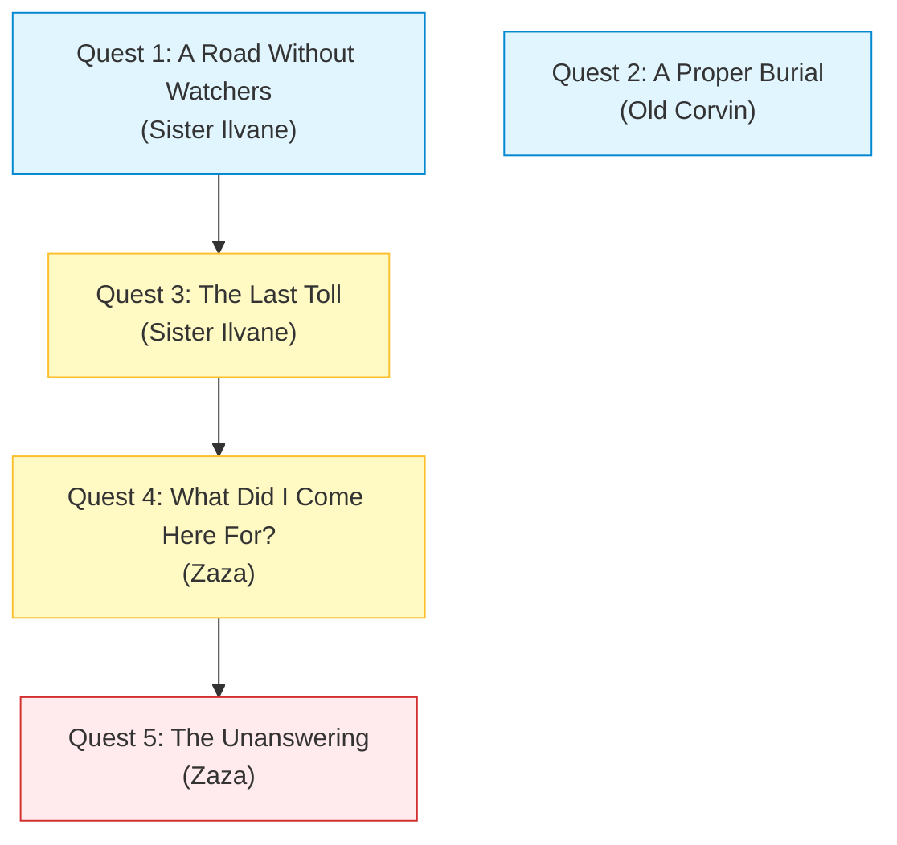

# 📖 World Design, Lore & Entity Index

Back to: [[00 - Dashboard]] | Plan: [[03 - Role B Plan & Milestones]] | Rules: [[04 - Game Rules & Formulas]]

---

## 1. Lore & Story of Morvane

> *King Aurenth of Morvane feared death. He ordered a colossal bell cast in black iron and rung to ask the abyss one question:*
> 
> ***"How can my kingdom never die?"***
> 
> *Something answered. Now nothing in Morvane can truly die, or truly live. The sun stopped rising, and the dead walk in circles.*
> 
> *You are a **Vigilant**, a corpse reawakened by the last unextinguished candle in the Votive Chapel. Every time you fall, its gentle flame drags you back to the threshold. To free this land, you must climb to the Bell Tower and silence the bell.*
> 
> *Yet the deepest secret remains buried: The bell did not wake the abyss. It woke **Baal**, ancient beyond time, slumbering beneath the ossuary. The kingdom's endless curse was Baal's answer — and only by bringing the question back to Baal can the curse be shattered.*

---

## 2. World Map Topology (11 Rooms)

```
                                      [Bell Tower] (Main Boss)
                                           │
                                           │ (north)
[Sunken Stair] ──── [Ossuary] ─────── [Throne Ruin] ─────── [Burned Library]
      │ (down)         │                                          │
[Hall of the       [Crypt Gate]                            [Hanged Garden]
  Answer]              │                                          │
 (Baal)            [Votive Chapel] ─── [Pilgrim's Road] ─── [Silent Market]
                     (Safe Haven)
```

### Map Features
- **The Loop (Full Circuit)**: Votive Chapel $\rightarrow$ Pilgrim's Road $\rightarrow$ Silent Market $\rightarrow$ Hanged Garden $\rightarrow$ Burned Library $\rightarrow$ Throne Ruin $\rightarrow$ Ossuary $\rightarrow$ Crypt Gate $\rightarrow$ Votive Chapel.
- **Branch 1 (North)**: Throne Ruin $\rightarrow$ Bell Tower (Main boss).
- **Branch 2 (West/Down)**: Ossuary $\rightarrow$ Sunken Stair $\rightarrow$ Hall of the Answer (Secret boss).

---

## 3. Room Catalog

| Room ID | Name | Exits | Items Placed | NPCs Present |
|---|---|---|---|---|
| `loc.votive_chapel` | Votive Chapel (Safe Room) | north: `loc.crypt_gate`<br/>east: `loc.pilgrims_road` | `item.pilgrims_candle` | `npc.sister_ilvane` |
| `loc.pilgrims_road` | Pilgrim's Road | west: `loc.votive_chapel`<br/>east: `loc.silent_market` | - | `npc.rotting_sentry` |
| `loc.silent_market` | Silent Market | west: `loc.pilgrims_road`<br/>north: `loc.hanged_garden` | `item.rusted_censer` | `npc.mute_merchant`<br/>`npc.zaza` |
| `loc.hanged_garden` | Hanged Garden | south: `loc.silent_market`<br/>north: `loc.burned_library` | `item.funeral_bread` | - |
| `loc.burned_library` | Burned Library | south: `loc.hanged_garden`<br/>west: `loc.throne_ruin` | `item.burial_shroud` | - |
| `loc.throne_ruin` | Throne Ruin | east: `loc.burned_library`<br/>west: `loc.ossuary`<br/>north: `loc.bell_tower` | `item.sealed_altar` | `npc.fallen_knight` |
| `loc.bell_tower` | Bell Tower | south: `loc.throne_ruin` | - | `npc.bell_warden` (Boss) |
| `loc.ossuary` | Ossuary | east: `loc.throne_ruin`<br/>south: `loc.crypt_gate`<br/>west: `loc.sunken_stair` | - | `npc.grave_hound` |
| `loc.crypt_gate` | Crypt Gate | north: `loc.ossuary`<br/>south: `loc.votive_chapel` | - | `npc.old_corvin` |
| `loc.sunken_stair` | Sunken Stair | east: `loc.ossuary`<br/>down: `loc.hall_answer` | `item.heralds_scroll` | - |
| `loc.hall_answer` | Hall of the Answer | up: `loc.sunken_stair` | - | `npc.baal` (Bonus Boss) |

---

## 4. NPC Roster

| NPC ID | Name | Role | Location | Stats (HP / Dmg) | Description & Lore |
|---|---|---|---|---|---|
| `npc.sister_ilvane` | Sister Ilvane | `quest_giver` | Votive Chapel | - | Gentle keeper of the last candle. Gives quests 1 & 3. |
| `npc.old_corvin` | Old Corvin | `quest_giver` | Crypt Gate | - | Weary gravedigger who has dug graves for 40 years. Gives quest 2. |
| `npc.mute_merchant` | Mute Merchant | `dialogue` | Silent Market | - | Has not spoken in 90 years; communicates through silent gestures. |
| `npc.zaza` | Zaza | `quest_giver` | Silent Market | - | Former Royal Herald who read the question. Broken by the answer. Gives quests 4 & 5. |
| `npc.rotting_sentry` | Rotting Sentry | `enemy` | Pilgrim's Road | 30 HP / 4-8 dmg | Undead guard patrolling an abandoned road. |
| `npc.grave_hound` | Grave Hound | `enemy` | Ossuary | 40 HP / 6-10 dmg | Skeletal beast gnawing on ancient skulls. |
| `npc.fallen_knight` | Fallen Knight | `enemy` | Throne Ruin | 80 HP / 8-12 dmg | Sworn bodyguard of King Aurenth's empty throne. |
| `npc.bell_warden` | Bell Warden | `enemy` (Boss) | Bell Tower | 150 HP / 10-16 dmg | Monstrous keeper bound to the iron bell rope. |
| `npc.baal` | Baal | `enemy` (Boss) | Hall of the Answer | 300 HP / 15-25 dmg | The primeval entity that answered the King. |

---

## 5. Item Catalog

| Item ID | Display Name | Obtainable? | Location | Effect / Bonus |
|---|---|---|---|---|
| `item.pilgrims_candle` | Pilgrim's Candle | `true` | Votive Chapel | Flavor item. Stub of wax refusing to burn down. |
| `item.rusted_censer` | Rusted Censer | `true` | Silent Market | Flavor item. Smells faintly of dried sage. |
| `item.funeral_bread` | Funeral Bread | `true` | Hanged Garden | Flavor item. Petrochemical bread from ancient rites. |
| `item.burial_shroud` | Burial Shroud | `true` | Burned Library | Required for Quest 2 (*A Proper Burial*). |
| `item.heralds_scroll` | Herald's Scroll | `true` | Sunken Stair | Required for Quest 4 (*What Did I Come Here For?*). |
| `item.sealed_altar` | Sealed Altar | `false` | Throne Ruin | Unobtainable world prop. Cannot be taken. |
| `item.vergers_hammer` | Verger's Hammer | `true` | Quest 2 Reward | $+6$ Attack Damage while carried in inventory. |
| `item.unspoken_question` | The Unspoken Question | `true` | Quest 4 Reward | Removes Baal's invulnerability when held in room. |

---

## 6. Quest Tree



| # | Quest ID | Title | Giver | Objective | Prerequisite | Reward |
|---|---|---|---|---|---|---|
| 1 | `road_without_watchers` | A Road Without Watchers | Sister Ilvane | Kill `npc.rotting_sentry` | None | $+2$ Attack Damage |
| 2 | `proper_burial` | A Proper Burial | Old Corvin | Deliver `item.burial_shroud` | None | `item.vergers_hammer` ($+6$ dmg), $+20$ MaxHP |
| 3 | `last_toll` | The Last Toll | Sister Ilvane | Kill `npc.bell_warden` | Quest 1 | $+5$ Attack Damage, Title "Unbound" |
| 4 | `what_did_i_come_for` | What Did I Come Here For? | Zaza | Deliver `item.heralds_scroll` | Quest 3 | `item.unspoken_question` |
| 5 | `unanswering` | The Unanswering | Zaza | Kill `npc.baal` | Quest 4 | Title "The Unanswered", Story Conclusion |
